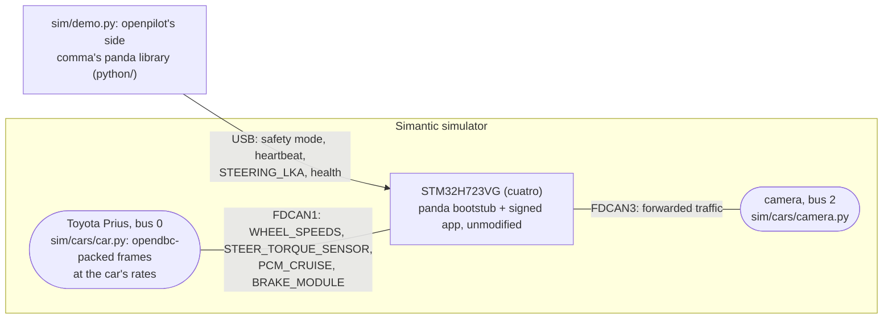

# Welcome to panda

> **This fork:** panda's own firmware (bootstub + signed app, built from this repo) runs on a simulated
> STM32H723, on a simulated Toyota Prius's CAN bus, driven by comma's own panda library. No hardware.

```sh
./demo build   # once: Python 3.12 venv with this repo's dependencies, the firmware, the car's frames
./demo         # needs `sim` on PATH: curl -fsSL https://simantic.com/install | sh
```


**[▶ Watch the 61 s explainer video](media/panda-demo-video.mp4)**



openpilot sets the safety mode it uses for a Prius (`toyota`, param from opendbc's `CarInterface`), and
panda's Toyota safety code decides what reaches the car: steering is blocked until panda sees cruise engage
on the car's bus, then allowed within limits, and an over-limit torque is blocked. Every car frame is packed
by opendbc from comma's Toyota DBC; the car replays them at the rates panda's safety checks. The host sleeps
in the simulator's time, so panda's timing checks see a real cadence.

Not modelled: the harness relay and ignition wiring, SPI to the comma device, and the car's response to
steering. The car is a replay, not a vehicle model. Simantic is a proprietary simulator, not open source.

### Tesla Model 3

```sh
./demo tesla   # the same single simulated panda, on a Tesla Model 3
```

openpilot's setup for `TESLA_MODEL_3` (`CarInterface.get_non_essential_params(...).safetyConfigs[0]`) puts
panda in the `tesla` safety mode. `sim/demo_tesla.py` feeds every `can_recv()` batch through opendbc's own
`CarInterface.update()`, the CarState parser openpilot's card.py runs, and builds `DAS_steeringControl`
with opendbc's `teslacan`. panda's Tesla safety checks messages on two buses, so both are replayed with
opendbc-packed counters and checksums (16 frames per message, cycled):

- bus 0, the car (`sim/cars/car.py`): `DI_speed`, `ESP_B`, `EPAS3S_sysStatus`, `DI_systemStatus`,
  `ESP_status`, `DI_state` (cruise `STANDBY`, then `ENABLED` at 6 s), `UI_warning`; steady 90 km/h.
- bus 2, the autopilot camera (`sim/cars/camera.py`): `DAS_control`, `DAS_steeringControl` (both checked by
  panda), plus `SCCM_steeringAngleSensor`, `DAS_status`, `DAS_settings` for CarState.

Real output:

```
panda 01eeffc0  firmware DEV-8ae88ad1-DEBUG
safety mode tesla param 0x0, as openpilot sets it for TESLA_MODEL_3

CANParser: bus 0 not valid (timeout or missing): 0x118 DI_systemStatus, 0x145 ESP_status, 0x155 ESP_B, 0x257 DI_speed, 0x286 DI_state, 0x311 UI_warning, 0x370 EPAS3S_sysStatus
   0.73 s  CarState vEgo=0.00 steeringAngleDeg=-0.0 cruiseState.enabled=False cruiseState.speed=0.00 gasPressed=False brakePressed=False standstill=False canValid=False | panda controls_allowed=False
   2.64 s  CarState vEgo=25.00 steeringAngleDeg=-0.0 cruiseState.enabled=False cruiseState.speed=27.78 gasPressed=False brakePressed=False standstill=False canValid=True | panda controls_allowed=False

cruise off: controls_allowed=False
   3.64 s  CarState vEgo=25.00 steeringAngleDeg=-0.0 cruiseState.enabled=False cruiseState.speed=27.78 gasPressed=False brakePressed=False standstill=False canValid=True | panda controls_allowed=False
   3.66 s  openpilot DAS_steeringControl angle +0.1 deg -> BLOCKED by panda
   4.78 s  CarState vEgo=25.00 steeringAngleDeg=-0.0 cruiseState.enabled=False cruiseState.speed=27.78 gasPressed=False brakePressed=False standstill=False canValid=True | panda controls_allowed=False
   6.37 s  CarState vEgo=25.00 steeringAngleDeg=-0.0 cruiseState.enabled=True cruiseState.speed=27.78 gasPressed=False brakePressed=False standstill=False canValid=True | panda controls_allowed=True

cruise on:  controls_allowed=True  (panda saw DI_state ENABLED by 6.48 s)
   7.19 s  openpilot DAS_steeringControl angle +0.1 deg -> sent to car
   7.34 s  openpilot DAS_steeringControl angle +10.0 deg -> BLOCKED by panda
   7.44 s  CarState vEgo=25.00 steeringAngleDeg=-0.0 cruiseState.enabled=True cruiseState.speed=27.78 gasPressed=False brakePressed=False standstill=False canValid=True | panda controls_allowed=True

health: safety_tx_blocked 2  safety_rx_invalid 0  faults 0

what reached the car's bus (the car's own log):
  cruise ENGAGED at 6.000 s
  on car bus: id=0x488 data=3fff21eb at 6.597 s
```

The first CarState is parsed before the car's first frames arrive, so opendbc reports them missing. The
10 deg step is over panda's angle rate limit at 90 km/h (`steer_angle_cmd_checks_vm`). Each USB round trip
costs simulated time, which is why openpilot's loop is slower than 10 Hz here.

### Tesla Model 3: replaying a real drive

```sh
./demo tesla-replay   # comma's public Model 3 test drive through the simulated panda, against the real panda's log
```

The drive is `79d0f04c82980004/00000003--fb0b5d9cfc` (`TESLA_MODEL_3` in opendbc's `car/tests/routes.py`, HW4 2025,
openpilot 0.11.2). `sim/replay/extract.py` downloads segment 7's rlog the way opendbc's car tests do (comma API
`/v1/route/<route>/files`, no login) and cereal's schema pinned at an openpilot commit, both into `../tesla-route/`
(not committed), and cuts a 30 s window around openpilot's engagement (6 s before the real panda's `controlsAllowed`
goes True) into JSON.

- The car (`sim/cars/replay.py`, bus 0) and camera (`sim/cars/replay_camera.py`, bus 2) send exactly the frames the
  real panda received (`can` with `src` 0 and 2) at their logged offsets in simulated time. `src` 128+ are panda's
  tx echoes and are not replayed. Each `can` event is one 100 Hz batch, so its frames are spread over the gap since
  the previous batch.
- The host (`sim/demo_tesla_replay.py`) sends openpilot's recorded `sendcan` (`DAS_steeringControl`, `APS_eacMonitor`)
  at their logged times and, at each logged `pandaStates` time, a heartbeat with `selfdriveState.enabled` and a health
  read. The safety mode and param come from the log's `carParams`.
- Then it compares, at each of the 298 `pandaStates` samples: `controls_allowed`, `safety_tx_blocked` (delta from
  the window start), `safety_rx_invalid` and `faults`.

Real output (about 10 minutes of wall time):

```
panda 01eeffc0  firmware DEV-8ae88ad1-DEBUG
drive 79d0f04c82980004/00000003--fb0b5d9cfc segment 7, TESLA_MODEL_3, openpilot 0.11.2 (4dbdd66e); cereal schema at openpilot b3ab22ef
safety mode tesla param 0x0, from the log's carParams
replaying 30 s of the drive from 3.0 s of simulated time

host: 1493 sendcan batches and 298 heartbeat+health reads over 29.9 s of drive, as logged; lateness vs log median 2.6 ms, p95 7.7 ms, max 8.3 ms

engage (controls_allowed False -> True): real 6.00 s  sim 6.00 s  (window time; logged engage 6.00 s)
safety_tx_blocked over the window: real +0  sim +0
safety model: real tesla param 0; sim tesla param 0

298 pandaStates samples compared; mismatches (field: real vs sim, at window times):
  faults: real interruptRateCan1,interruptRateCan2 vs sim none  (298 samples, 0.07..29.91 s)

openpilot's frames sent to panda (bus 0): 0x27d:299 0x488:1493; compare 'frames from panda' on bus 0 below
panda bus 0: total_tx_cnt 14027 total_tx_lost_cnt 0 total_fwd_cnt 75416 bus_off_cnt 0; usb rx_buffer_overflow 176588 tx_buffer_overflow 0

what reached the car's bus (the car's own log):
  bus 0: replay done at 32.990 s; frames from panda by id: 0x051:2999 0x11b:646 0x129:2872 0x12b:300 0x209:749 0x20a:44 0x20e:300 0x248:300 0x25d:343 0x27d:1 0x293:60 0x299:1500 0x2b9:751 0x32b:64 0x34f:174 0x389:65 0x39b:65 0x3e9:60 0x40c:30 0x488:4 0x489:1500 0x5d0:30 0x5d1:120 0x5d4:375 0x5e5:375 0x7ff:300
```

What matches: the safety mode, the engagement (`controls_allowed` goes True at the same pandaStates sample as on the
real panda, driven only by the car's own `DI_state` on the bus), `controls_allowed` at every sample, no blocked
openpilot frames, and no `safety_rx_invalid`. Every rx check passed on the recorded counters and checksums.

What does not match:

- `faults`: the real panda reports `interruptRateCan1,interruptRateCan2` at every sample. They were already set when
  the segment started (panda uptime 2590 s). The simulated panda raises none on the same traffic.
- `faults`: unchanged by the TFE fix below.
- openpilot's frames mostly do not reach the car. The real panda echoed all 1493 `0x488` and 298 `0x27d` in this
  window (`src` 128), with `txBufferOverflow` 0. In the simulation, 4 `0x488` and 1 `0x27d` reached the car, with
  `safety_tx_blocked` 0, so panda's safety did not reject them.
  One cause is found and fixed: pyrite's H7 FDCAN never set `FDCAN_IR.TFE` (Tx FIFO empty, RM0468 FDCAN_IR bit 11).
  panda routes only TFE to interrupt line 1 (`llfdcan.h`), and that ISR drains its software CAN tx queue, so the
  queues stayed full and panda stopped taking USB bulk transfers (`can_tx_check_min_slots_free`). With the fix
  ([pyrite#3662](https://github.com/simantic-dev/pyrite/pull/3662)) `tx_buffer_overflow` drops from 2533 to 0 and
  every forwarded id now arrives at its logged rate, but `0x488`/`0x27d` still arrive 4 and 1 times. The rest of the
  cause is not found yet. This host never calls `can_recv` (each USB packet costs simulated time), so panda's USB rx
  queue still overflows (`rx_buffer_overflow` 176588; the real panda logged 0).
- Timing: the host's sends land 2.6 ms late (median) and at most 8.3 ms late, against the log.

The firmware differs. The drive ran openpilot 0.11.2 (`4dbdd66e`), whose panda submodule is `92eb5651` with opendbc
`4134c0d1`. The log does not record the panda firmware version itself. This repo is panda `8ae88ad1` (54 commits later)
with opendbc `6cd8a71d`. Between those, `opendbc/safety/modes/tesla.h` changed only by refactors: safety state moved into
a struct, a shared rising-edge latch, `GET_BYTES_BE`/`GET_BIT`, float suffixes and include guards (opendbc #3924, #3962,
#3967, #3974, #3976, #3984, #3991, #3992). No limit or rule changed.


panda speaks CAN and CAN FD, and it runs on the [STM32H725](https://www.st.com/resource/en/reference_manual/rm0468-stm32h723733-stm32h725735-and-stm32h730-value-line-advanced-armbased-32bit-mcus-stmicroelectronics.pdf).

## Directory structure

```
.
├── board           # Code that runs on the STM32
├── python          # Python userspace library for interfacing with the panda
├── tests           # Tests for panda
├── scripts         # Miscellaneous used for panda development and debugging
├── examples        # Example scripts for using a panda in a car
```

## Safety Model

panda is compiled with vehicle-specific safety logic provided by [opendbc](https://github.com/commaai/opendbc). See details about the car safety models, safety testing, and code rigor in that repository.

## Code Rigor

The panda firmware is written for its use in conjunction with [openpilot](https://github.com/commaai/openpilot). The panda firmware, through its safety model, provides and enforces the
[openpilot safety](https://github.com/commaai/openpilot/blob/master/docs/SAFETY.md). Due to its critical function, it's important that the application code rigor within the `board` folder is held to high standards.

These are the [CI regression tests](https://github.com/commaai/panda/actions) we have in place:
* A generic static code analysis is performed by [cppcheck](https://github.com/danmar/cppcheck/).
* In addition, [cppcheck](https://github.com/danmar/cppcheck/) has a specific addon to check for [MISRA C:2012](https://misra.org.uk/) violations. See [current coverage](https://github.com/commaai/panda/blob/master/tests/misra/coverage_table).
* Compiler options are strict: the flags `-Wall -Wextra -Wstrict-prototypes -Werror` are enforced.
* The [safety logic](https://github.com/commaai/panda/tree/master/opendbc/safety) is tested and verified by [unit tests](https://github.com/commaai/panda/tree/master/opendbc/safety/tests) for each supported car variant to ensure that the behavior remains unchanged.
* A hardware-in-the-loop test verifies panda's functionalities on all active panda variants, including:
  * additional safety model checks
  * compiling and flashing the bootstub and app code
  * receiving, sending, and forwarding CAN messages on all buses
  * CAN loopback and latency tests through SPI

The above tests are themselves tested by:
* a [mutation test](tests/misra/test_mutation.py) on the MISRA coverage
* a [mutation test]([tests/misra/test_mutation.py](https://github.com/commaai/opendbc/blob/master/opendbc/safety/tests/mutation.sh)) on the vehicle-specific safety logic

## Usage

```bash
git clone https://github.com/commaai/panda.git
cd panda

# setup your environment
./setup.sh

# build fw + run the tests
./test.sh
```

See [the Panda class](https://github.com/commaai/panda/blob/master/python/__init__.py) for how to interact with the panda.

For example, to receive CAN messages:
``` python
>>> from panda import Panda
>>> panda = Panda()
>>> panda.can_recv()
```
And to send one on bus 0:
``` python
>>> from opendbc.car.structs import CarParams
>>> panda.set_safety_mode(CarParams.SafetyModel.allOutput)
>>> panda.can_send(0x1aa, b'message', 0)
```
Note that you may have to setup [udev rules](https://github.com/commaai/panda/tree/master/drivers/linux) for Linux, such as
``` bash
sudo tee /etc/udev/rules.d/11-panda.rules <<EOF
SUBSYSTEM=="usb", ATTRS{idVendor}=="0483", ATTRS{idProduct}=="df11", MODE="0666"
SUBSYSTEM=="usb", ATTRS{idVendor}=="3801", ATTRS{idProduct}=="ddcc", MODE="0666"
SUBSYSTEM=="usb", ATTRS{idVendor}=="3801", ATTRS{idProduct}=="ddee", MODE="0666"
SUBSYSTEM=="usb", ATTRS{idVendor}=="bbaa", ATTRS{idProduct}=="ddcc", MODE="0666"
SUBSYSTEM=="usb", ATTRS{idVendor}=="bbaa", ATTRS{idProduct}=="ddee", MODE="0666"
EOF
sudo udevadm control --reload-rules && sudo udevadm trigger
```

## Licensing

panda software is released under the MIT license unless otherwise specified.
